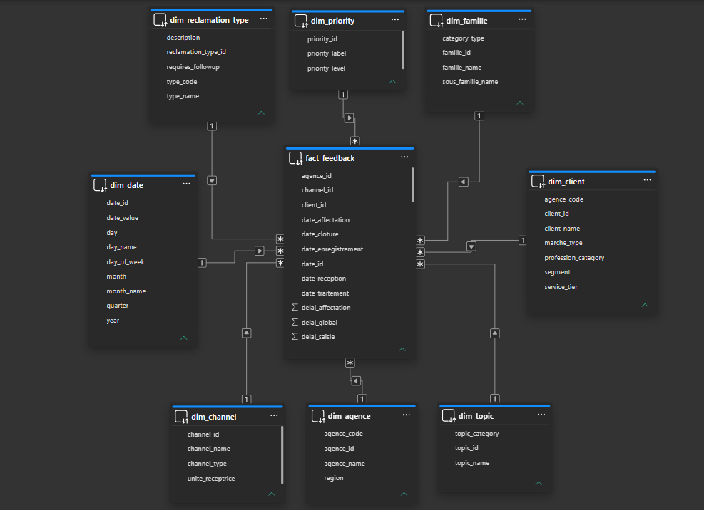
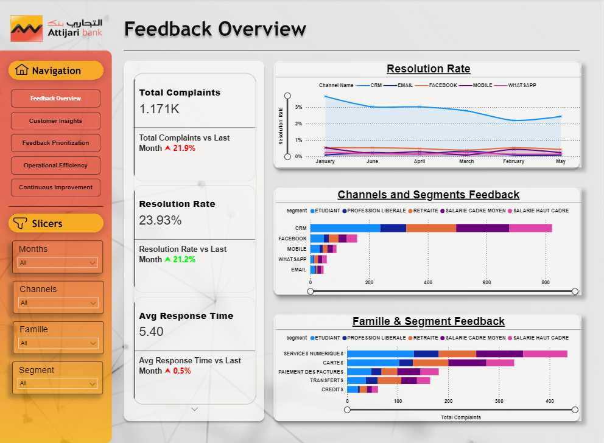
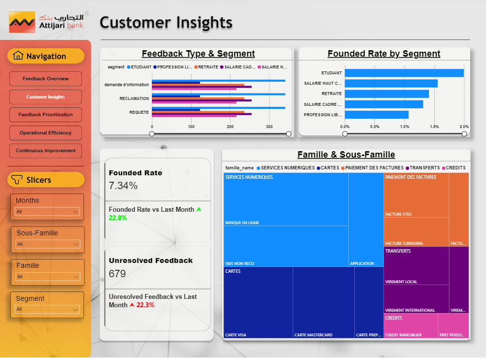
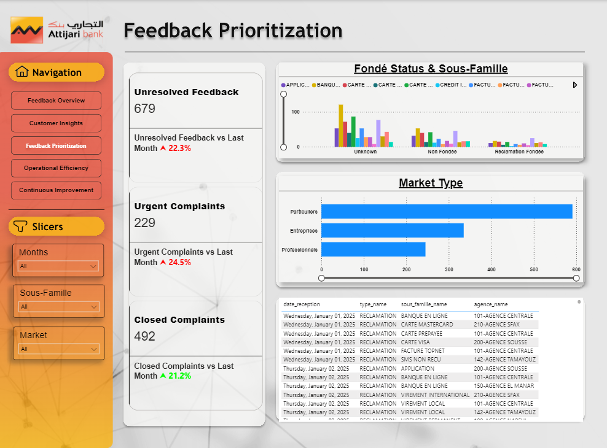
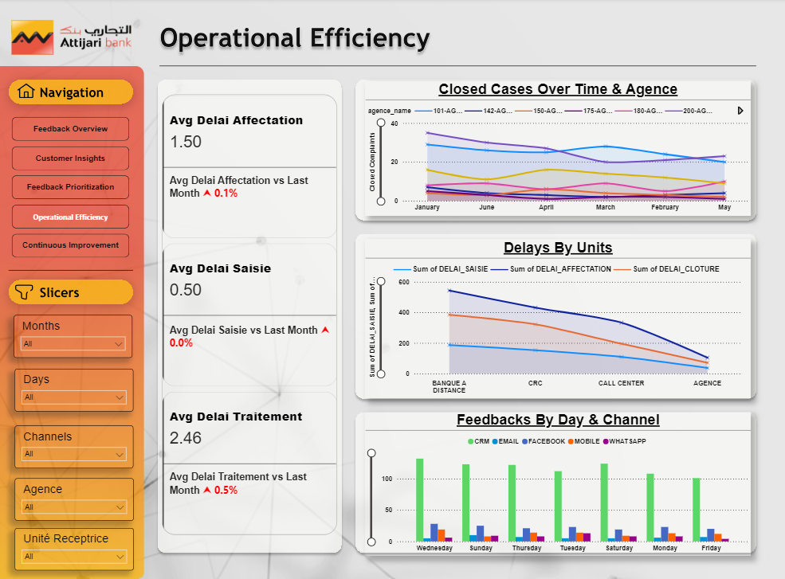
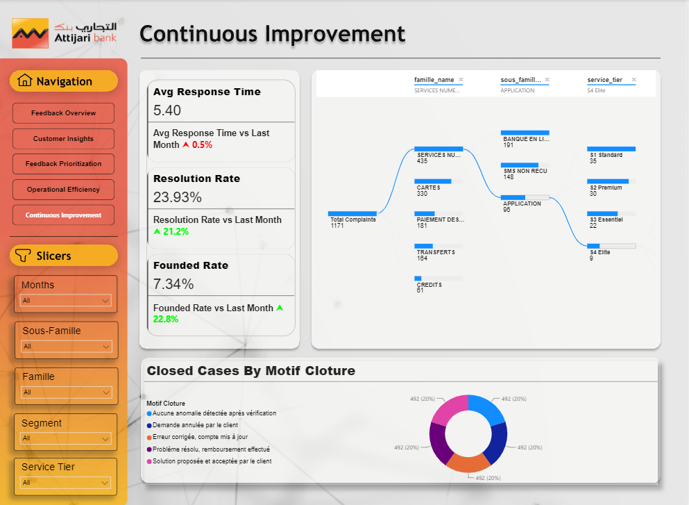

# Customer Feedback Business Intelligence Dashboard — Attijari Bank Tunisia

An interactive Power BI solution designed to monitor customer feedback, analyze complaint resolution performance, and identify opportunities to improve operational efficiency and customer experience.

---

## Table of Contents

- [Project Overview](#project-overview)
- [Business Objectives](#business-objectives)
- [Tools and Technologies](#tools-and-technologies)
- [Data Model](#data-model)
- [Key Performance Indicators](#key-performance-indicators)
- [Dashboard Pages](#dashboard-pages)
- [Business Value](#business-value)
- [Project Structure](#project-structure)

---

## Project Overview

Customer feedback provides valuable information about service quality, recurring issues, and operational performance. However, analyzing this information effectively requires a structured data model and clear performance indicators.

This project focuses on developing an interactive **Power BI dashboard for customer feedback and complaint management at Attijari Bank Tunisia**.

The report consolidates key indicators into five analytical pages, enabling stakeholders to monitor complaint volumes, investigate customer feedback patterns, assess resolution performance, and analyze operational delays.

The solution combines dimensional data modeling, DAX measures, interactive filtering, and business-oriented data visualization to transform structured feedback data into a practical decision-support tool.

### Project at a Glance

| Category | Description |
|---|---|
| Business domain | Customer experience and complaint management |
| Organization | Attijari Bank Tunisia |
| Reporting platform | Microsoft Power BI |
| Data source | Microsoft SQL Server Data Warehouse |
| Data modeling | Fact table and dimension tables |
| Calculations | DAX measures |
| Main focus | Complaint monitoring, prioritization, and operational efficiency |
| Report pages | 5 |

## Business Objectives

The dashboard was designed to help stakeholders answer five groups of business questions.

### 1. Feedback Monitoring
- How many complaints are being received?
- What is the current resolution rate?
- How is average response time evolving?
- Which channels and customer segments generate the most feedback?

### 2. Customer Insights
- How do feedback types vary across customer segments?
- Which segments have the highest justified complaint rates?
- Which product and service families generate the most feedback?

### 3. Feedback Prioritization
- How many complaints remain unresolved?
- How many cases are classified as urgent?
- How many complaints have been closed?
- Which service categories and market segments contribute most to the workload?

### 4. Operational Efficiency
- What are the average assignment, data-entry, and treatment delays?
- How does closure performance vary across agencies?
- Which processing units experience the greatest delays?
- How does feedback volume vary across days and channels?

### 5. Continuous Improvement
- How are response and resolution indicators evolving?
- Which service categories require closer monitoring?
- What are the most common complaint closure motives?
- Where should corrective actions be prioritized?

## Tools and Technologies

| Technology | Role |
|---|---|
| **Microsoft Power BI** | Interactive dashboards and business reporting |
| **DAX** | KPI calculations and month-over-month comparisons |
| **Microsoft SQL Server** | Structured data storage and analytical data source |
| **Dimensional Modeling** | Organizing feedback records and descriptive dimensions |

## Data Model

The Power BI semantic model follows a dimensional structure, centered on a fact table connected to descriptive dimension tables.

### Model Structure

| Table | Purpose |
|---|---|
| `fact_feedback` | Central table containing feedback records, related identifiers, dates, and operational delay measures |
| `dim_date` | Calendar attributes for analyzing trends over time |
| `dim_channel` | Communication channel and receiving-unit information |
| `dim_client` | Customer characteristics, market type, segment, profession category, and service tier |
| `dim_famille` | Product and service families and sub-families |
| `dim_agence` | Agency identifiers, names, codes, and regions |
| `dim_topic` | Feedback topics and topic categories |
| `dim_reclamation_type` | Complaint types, descriptions, and follow-up requirements |
| `dim_priority` | Complaint priority labels and levels |

This structure supports analysis across time, channels, customer segments, service categories, agencies, and complaint characteristics.

### Data Model Diagram

Add your Power BI relationship-model screenshot to the repository and update the image path below.

## Key Performance Indicators

The report uses DAX measures to monitor feedback volumes, resolution performance, complaint prioritization, and processing delays.

| KPI | Purpose |
|---|---|
| **Total Complaints** | Monitor the volume of feedback received |
| **Resolution Rate** | Evaluate complaint resolution performance |
| **Average Response Time** | Monitor response time |
| **Unresolved Feedback** | Track the outstanding complaint backlog |
| **Urgent Complaints** | Monitor complaints classified as urgent |
| **Closed Complaints** | Track the volume of closed cases |
| **Founded Rate** | Monitor the proportion of complaints classified as justified |
| **Average Assignment Delay** | Evaluate the time required to assign complaints |
| **Average Entry Delay** | Monitor the time required to register feedback |
| **Average Treatment Delay** | Evaluate complaint processing time |
| **Monthly KPI Variation** | Compare indicators against the previous month |

The KPI cards and comparisons provide a quick overview of current performance, while interactive visuals allow users to investigate the underlying patterns.

## Dashboard Pages

The report consists of five interconnected Power BI pages, each designed around a specific analytical objective.

### 1. Feedback Overview

**Purpose:** Provide a high-level overview of customer feedback performance.

**Key visuals:**
- Total complaints, resolution rate, and average response time.
- Monthly performance comparisons.
- Resolution rate by communication channel.
- Feedback distribution by channel and customer segment.
- Complaint volumes across product and service families.

### 2. Customer Insights

**Purpose:** Analyze feedback patterns across customer segments and service categories.

**Key visuals:**
- Feedback type by customer segment.
- Justified complaint rate by segment.
- Family and sub-family treemap.
- Unresolved feedback indicator.

### 3. Feedback Prioritization

**Purpose:** Monitor the complaint backlog and identify cases requiring attention.

**Key visuals:**
- Unresolved feedback, urgent complaints, and closed complaints.
- Complaint status by service category.
- Feedback distribution by market type.
- Detailed feedback table for further investigation.

### 4. Operational Efficiency

**Purpose:** Evaluate complaint-handling performance across agencies and processing units.

**Key visuals:**
- Average assignment, data-entry, and treatment delays.
- Closed cases over time and by agency.
- Delays across processing units.
- Feedback volume by day and communication channel.

### 5. Continuous Improvement

**Purpose:** Support the investigation of recurring service issues and improvement opportunities.

**Key visuals:**
- Response time, resolution rate, and justified complaint rate.
- Family, sub-family, and service-tier decomposition.
- Closed cases by closure motive.

## Business Value

The dashboard provides a structured view of customer feedback and complaint management, helping stakeholders move from raw records to actionable operational insights.

Key contributions include:

- **Centralized monitoring:** Consolidates essential feedback indicators into one reporting environment.
- **Performance visibility:** Makes complaint volumes, resolution rates, and processing delays easier to monitor.
- **Customer insights:** Enables comparisons across customer segments, channels, and service categories.
- **Operational analysis:** Helps identify differences in processing delays and workload across agencies and receiving units.
- **Prioritization support:** Highlights unresolved and urgent feedback for further investigation.
- **Continuous improvement:** Provides analytical views to investigate recurring issues and identify opportunities for service improvement.

---

## Author

**Ayoub Ben Bouyahia**

Business Analytics | Business Intelligence | Power BI | Data Analysis

